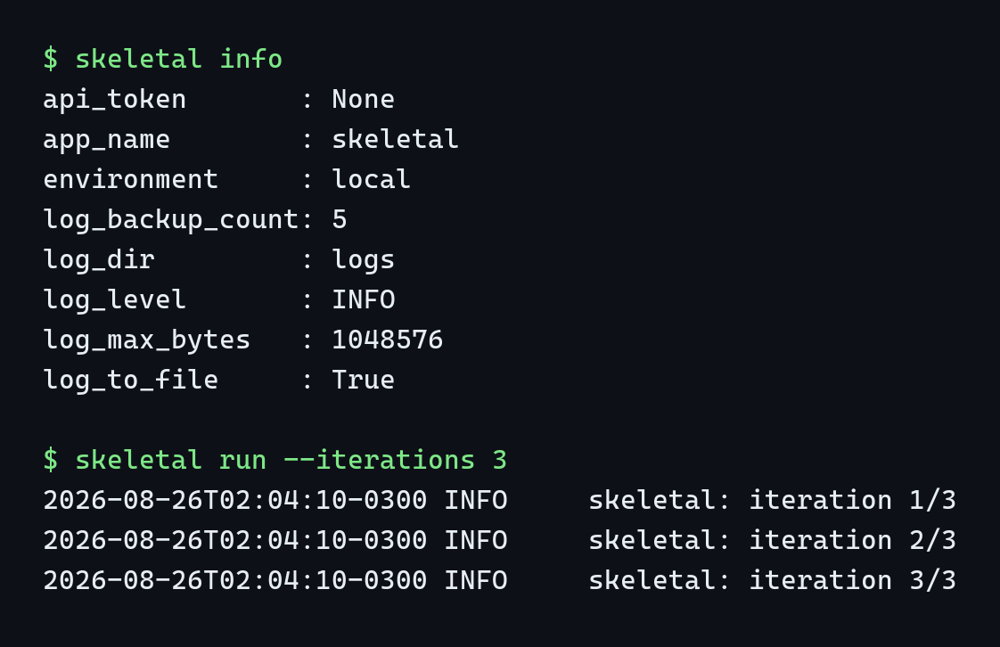

# python-skeletal

A modern Python project template: `uv` for packaging and locking, `ruff` for linting and
formatting, `mypy --strict` for types, `pytest` with a coverage gate, `pre-commit` hooks,
a multi-OS CI matrix, and a distroless-style Docker image. Use it as a GitHub Template
repository or generate a project from it with `copier`.

[](https://github.com/lucas-lima-s/python-skeletal/actions/workflows/ci.yml)

[](LICENSE)
[](https://github.com/astral-sh/ruff)

## Why

Most "quick" project bootstraps I have seen (including my own past ones) share the same
four failure modes, and this template exists to avoid all of them by construction:

- **Import-time config loading with a hardcoded absolute interpreter path.** A config
  object gets built at module import time from a JSON file that hardcodes one developer's
  local interpreter path, so the module cannot even be imported on a different machine.
  Here, configuration is a lazily-constructed, cached `pydantic-settings` object
  (`get_settings()`), never evaluated at import time, never assuming a path.
- **Shell bootstrap scripts that silently no-op when the config key does not match.** A
  `.bat`/`.sh` setup script parses a config file looking for one key spelling, the real key
  is spelled differently, and the script quietly proceeds with an empty variable instead of
  failing loudly. Here, there is no shell bootstrap at all: `uv sync` is the only setup step,
  and it fails loudly on any real problem.
- **A `None`-initialised global logger that turns any startup failure into an
  `AttributeError`.** A module-level `logger: Logger | None = None` gets assigned only
  inside a `setup_logging()` call; if that call raises before assignment, every `except`
  branch that logs the error crashes on `None.info(...)` instead of reporting the original
  problem. Here, `configure_logging()` returns the logger it configures, is idempotent, and
  is the only thing that touches the package logger.
- **File-only logging with no console handler.** Nothing is visible until someone goes
  digging for a log file. Here, a `StreamHandler` to `stderr` is always installed; the
  rotating file handler is additive and optional.

## What's inside

```
python-skeletal/
├── src/skeletal/            # the importable package
│   ├── __init__.py          # public API: __version__, Settings, get_settings, configure_logging
│   ├── __main__.py          # `python -m skeletal` entrypoint
│   ├── cli.py                # argparse-based CLI: --version, info, run
│   ├── config.py             # pydantic-settings Settings model
│   ├── logging_setup.py      # idempotent logger configuration
│   └── py.typed              # PEP 561 marker, ships in the wheel
├── tests/                   # pytest suite, >=90% coverage gate
├── scripts/rename_project.py # turns this template into a new project
├── copier.yml                # copier entrypoint (delegates to rename_project.py)
├── .github/workflows/ci.yml  # lint + multi-OS test matrix + docker build
├── .github/dependabot.yml    # uv + github-actions update PRs
├── .pre-commit-config.yaml   # trailing-whitespace, ruff, mypy
├── Dockerfile                 # multi-stage, non-root runtime user
└── pyproject.toml
```

## Quick start

Pick one:

**1. GitHub Template button** (recommended for a new repo) — click "Use this template" on
GitHub, clone your new repo, then rename it in place:

```console
$ python scripts/rename_project.py \
    --project-name my-app \
    --author-name "Your Name" \
    --author-email you@example.com \
    --github-user your-gh-user \
    --apply
$ uv lock
```

**2. Copier** — generate a project without touching GitHub first:

```console
$ uv tool install copier
$ copier copy gh:lucas-lima-s/python-skeletal my-app
$ cd my-app && uv lock
```

**3. Clone for reading** — `git clone` if you just want to study the layout.

`rename_project.py` runs as a dry run by default (prints the planned edits, touches
nothing); pass `--apply` to actually write. `uv.lock` is intentionally not carried over
by either path, since a renamed project has a different dependency graph fingerprint —
`uv lock` is the required first step after generation.

## Layout

- **`src/` layout**: the package is only importable after an actual install
  (`uv sync` / `pip install -e .`), which is what catches "works on my machine because the
  repo root is on `sys.path`" bugs before they ship.
- **`py.typed`**: marks the package as inline-typed (PEP 561) so downstream consumers get
  full `mypy`/`pyright` support instead of `Any` everywhere.
- **Console script over ad-hoc scripts**: `skeletal` is registered via
  `[project.scripts]`, so it is a real, `PATH`-resolvable command after install, identical
  in behavior to `python -m skeletal`.

## Configuration

All settings are environment variables with the `SKELETAL_` prefix, optionally loaded from
a `.env` file (see `.env.example`). `Settings` is frozen — treat it as a snapshot, not a
place to stash mutable state.

| Variable | Type | Default |
|---|---|---|
| `SKELETAL_APP_NAME` | `str` | `skeletal` |
| `SKELETAL_ENVIRONMENT` | `local \| dev \| staging \| prod` | `local` |
| `SKELETAL_LOG_LEVEL` | `DEBUG \| INFO \| WARNING \| ERROR \| CRITICAL` | `INFO` |
| `SKELETAL_LOG_DIR` | path | `logs` |
| `SKELETAL_LOG_TO_FILE` | `bool` | `true` |
| `SKELETAL_LOG_MAX_BYTES` | `int` (`>=1024`) | `1048576` |
| `SKELETAL_LOG_BACKUP_COUNT` | `int` (`>=0`) | `5` |
| `SKELETAL_API_TOKEN` | secret, optional | unset |

`skeletal info` prints the resolved settings with secrets redacted; `SKELETAL_API_TOKEN`
never appears in plaintext in `info` output or in log files.

## Logging

`configure_logging(settings)` configures the `"skeletal"` logger (not the root logger):
a `stderr` stream handler is always attached, and a `RotatingFileHandler` under
`SKELETAL_LOG_DIR` is added when `SKELETAL_LOG_TO_FILE=true`. The function is idempotent —
calling it repeatedly in the same process replaces its own handlers instead of stacking
duplicates, which is what lets the CLI call it freely without special-casing "have I already
set this up?".

## Commands

```console
$ skeletal --version
skeletal 0.1.0

$ skeletal info --json
{
  "api_token": null,
  "app_name": "skeletal",
  "environment": "local",
  "log_backup_count": 5,
  "log_dir": "logs",
  "log_level": "INFO",
  "log_max_bytes": 1048576,
  "log_to_file": true
}

$ skeletal run --iterations 3
2026-08-26T00:00:00+0000 INFO     skeletal: iteration 1/3
2026-08-26T00:00:00+0000 INFO     skeletal: iteration 2/3
2026-08-26T00:00:00+0000 INFO     skeletal: iteration 3/3
```



## Development

```console
$ uv sync --all-groups
$ uv run ruff check .
$ uv run ruff format --check .
$ uv run mypy
$ uv run pytest
$ uv run pre-commit install
```

## Docker

```console
$ docker build -t python-skeletal .
$ docker run --rm python-skeletal --version
```

The image is multi-stage: dependencies are resolved and compiled in a `uv`-enabled builder
stage, then only the resulting virtual environment is copied into a slim runtime stage that
executes as a non-root user (uid `10001`). File logging is disabled by default in the image
(`SKELETAL_LOG_TO_FILE=false`) since container logs belong on stdout/stderr.

## CI

The `ci.yml` workflow runs three jobs on every push and pull request against `main`:

- **lint** — `ruff check`, `ruff format --check`, `mypy`, on Python 3.14.
- **test** — `pytest` across an 8-job matrix: Python 3.11–3.14 on Ubuntu, plus the
  minimum and maximum supported versions (3.11 and 3.14) on Windows and macOS.
- **docker** — builds the image to catch `Dockerfile` regressions.

Dependabot opens weekly update PRs for both the `uv` lockfile and the GitHub Actions pins.

## License

MIT, see [LICENSE](LICENSE).
